# CalcX: Calculator & Converter App

An all-in-one offline calculator and converter application built with Flutter, designed for students, engineers, developers, and everyday users. It consolidates mathematical tools, scientific utilities, physics and chemsitry calculators, statistics tools, computer science converters, and unit conversion systems into a single organized platform.

   
  
    

---

## Mockups

| **Home** | **Scientific Calculator** | **Formula Guide** |
| :---: | :---: | :---: |
| 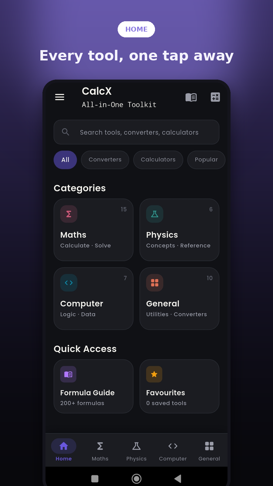 | 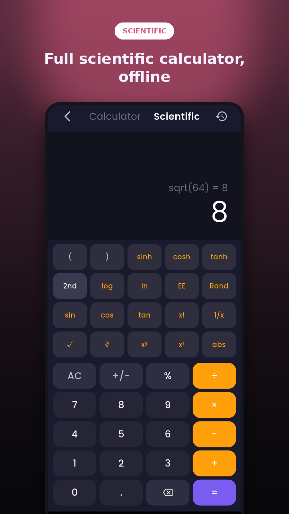 | 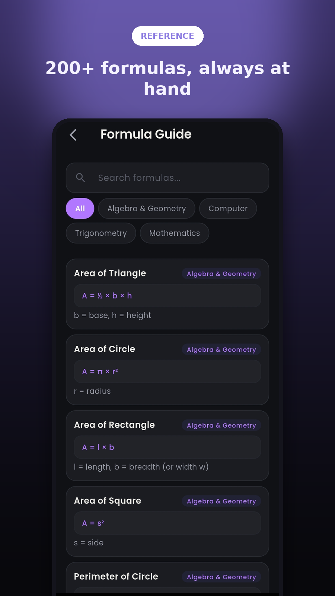 |
| **Periodic Table** | **Matrices** | **Favourites** |
| 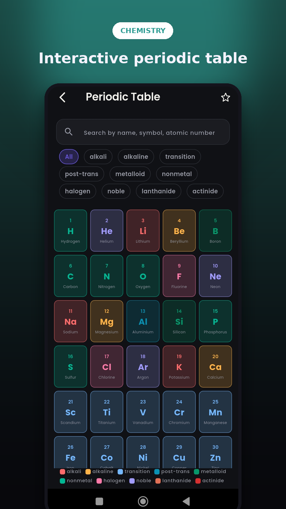 | 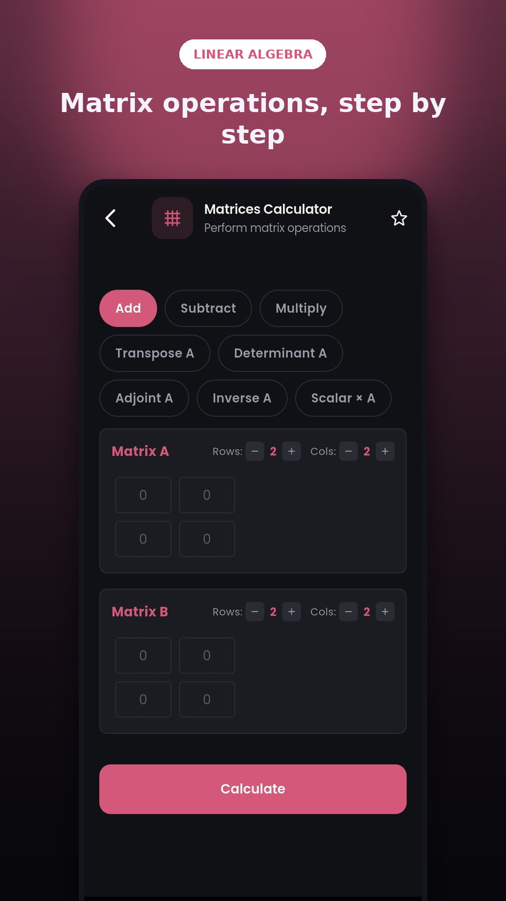 | 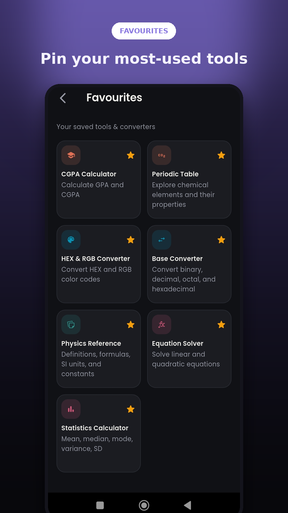 |
| **History** | **Mathematics** | **Computer Science** |
| 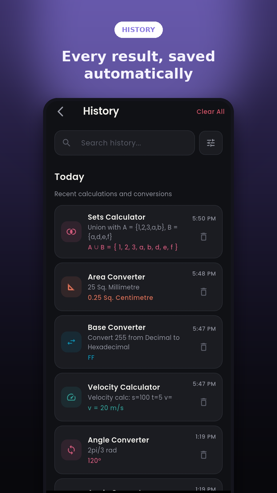 | 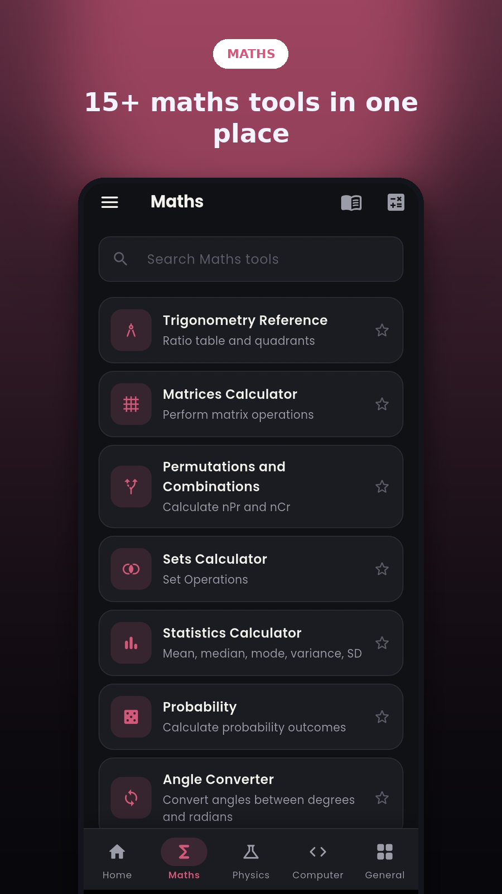 | 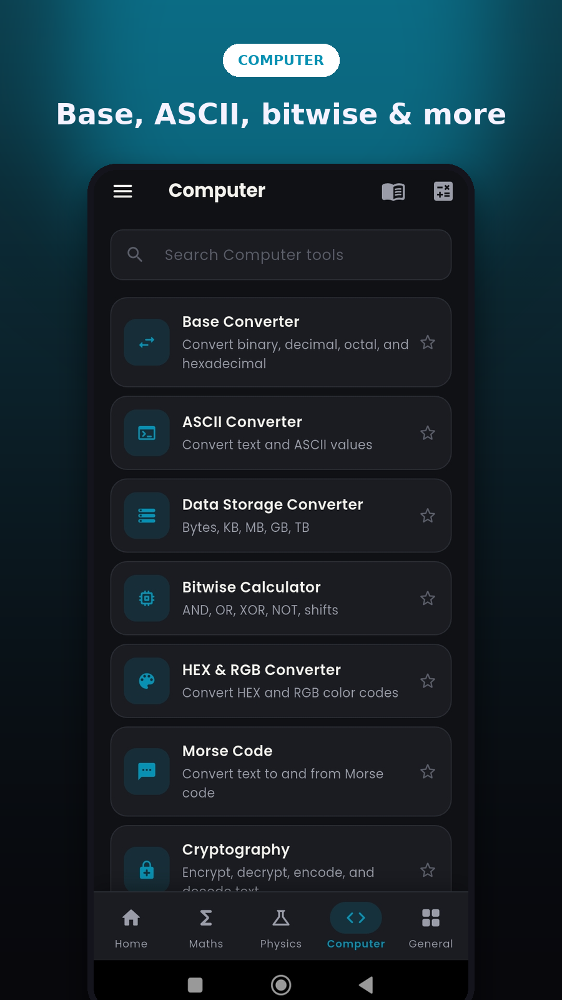 |
| **Physics** | **General Tools** | **Step-by-Step Solutions** |
| 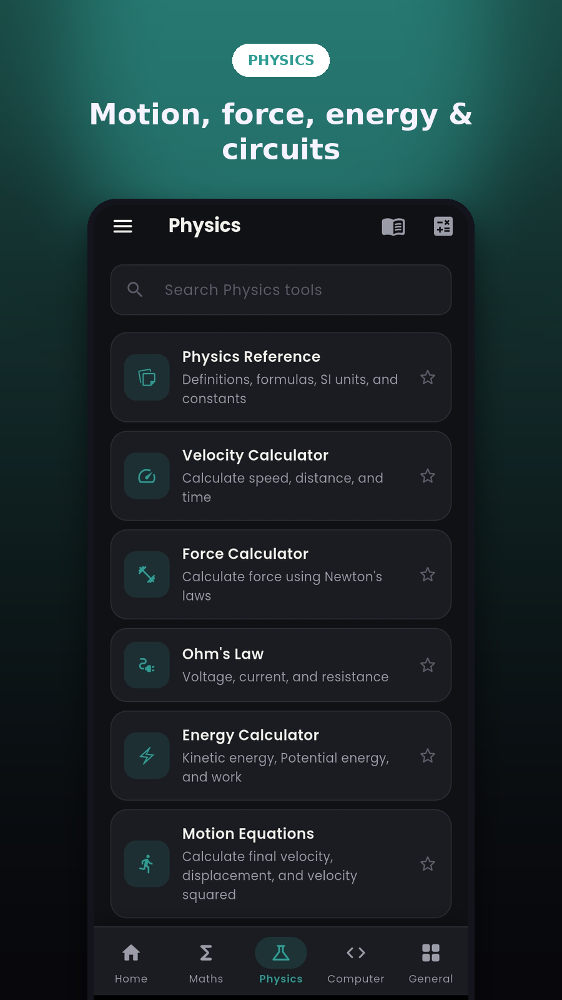 | 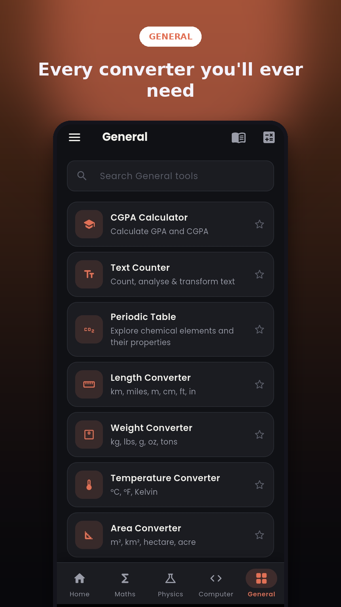 | 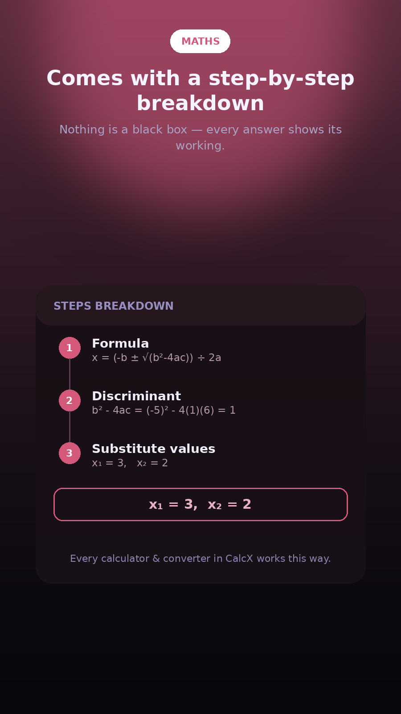 |

---

## Overview

It is designed around a simple principle: users should not need to download multiple separate apps for common academic and engineering tasks. The application works entirely offline, stores all history and preferences locally on device, and provides step-by-step breakdowns for mathematical tools to support learning.

---

## Features

- Fully offline — no internet connection required
- Standard and scientific calculator with history logging
- Formula Guide with 200+ formulas
- Step-by-step solution breakdowns for all math tools
- Favourites system to save frequently used tools
- Calculation history with grouped timeline view
- Search across all tools from the home screen
- Dark and light theme with persistent preference
- Swipe navigation between categories
- Responsive layout for phones and tablets
- Poppins typeface throughout

---

## Tool Categories

### Mathematics
- LCM & HCF
- Matrices
- Sets
- Trigonometry
- Permutations (nPr and nCr)
- Statistics (mean, median, mode, variance, standard deviation)
- Probability
- Angle Converter (degrees and radians)
- Roman Numerals Converter
- Percentage Calculator
- Prime Number Checker
- Equation Solver (linear and quadratic)
- Fraction Calculator
- Ratio Calculator
- Simple and Compound Interest Calculator

### Science
- Physics Reference - formulas, definitions, SI units, and constants
- Periodic Table
- Velocity Calculator (speed, distance, or time)
- Force Calculator (Newton's laws)
- Ohm's Law (voltage, current, and resistance)
- Energy Calculator (kinetic energy, potential energy, and work)
- Motion Equations
- Dual Nature (de Broglie wavelength and photon energy)
- Order of Reaction (concentration and half-life)
- Quantum Model (quantum numbers, orbitals, and nodes)
- Schrodinger Equation (particle-in-a-box energy and wavefunction)
- Molar Mass Calculator
- Mole Converter (grams, moles, and particles)
- Molality Calculator
- Normality Calculator
- PPB and PPM Concentration Calculators
- Solution Preparation Calculator

### Computer Science
- Base Converter (decimal, binary, octal, hexadecimal)
- ASCII Converter (character to code and code to character)
- Data Storage Converter (bytes, KB, MB, GB, and TB)
- Bitwise Calculator (AND, OR, XOR, NOT, bit shifts)
- HEX & RGB Color Converter
- Morse Code Converter
- Cryptography (encrypt, decrypt, encode, and decode)

### General
- Counter & Stopwatch
- CGPA Calculator
- Text Counter & Transform
- Length Converter
- Weight Converter
- Temperature Converter (Celsius, Fahrenheit, Kelvin)
- Area Converter
- Speed Converter
- Age Calculator
- BMI Calculator

### Calculator
- Standard calculator with expression history
- Scientific calculator with trigonometric, logarithmic, hyperbolic, and algebraic functions
- 2nd shift for inverse functions (sin⁻¹, cos⁻¹, tan⁻¹, sinh⁻¹, cosh⁻¹, tanh⁻¹, log₂, eˣ, 10ˣ)

---

## Tech Stack

| Layer | Technology |
|---|---|
| Framework | Flutter |
| Language | Dart |
| State Management | Flutter Riverpod |
| Local Storage | Hive + Hive Flutter |
| Navigation | go_router |
| Typography | Poppins (self-hosted) |
| Utilities | math_expressions, uuid, intl |
| Code Generation | build_runner, hive_generator, riverpod_generator |

---

## About this repo

This repo showcases the app's architecture — a select set of structural files (entry point, router, and a sample model) are included to demonstrate real, working code. The full implementation remains private.

---

## Built By

**Sabiha Niaz** — Flutter Developer
[LinkedIn](https://www.linkedin.com/in/sabiha-niaz-864771383/) · [GitHub](https://github.com/sabihaniaz7)

*Developed as part of an Android Developer internship at [NexAppra](https://www.nexappra.com/).*
